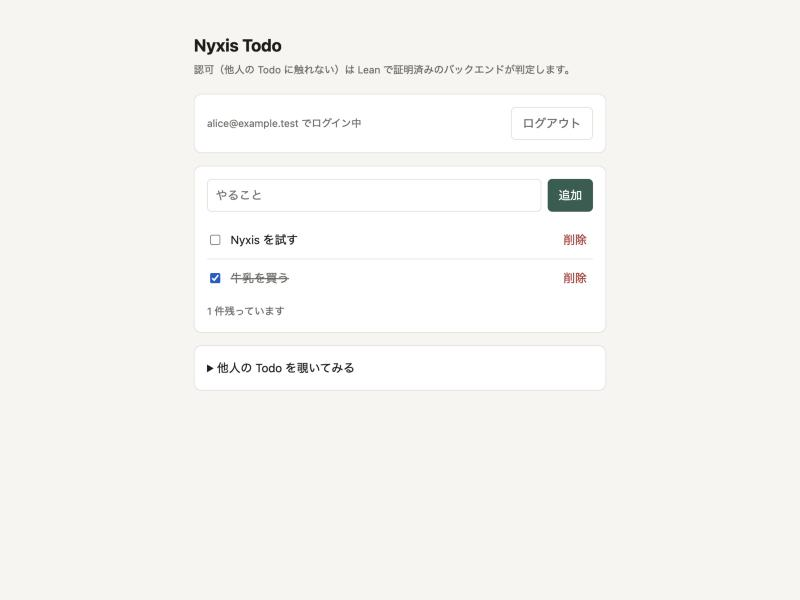

# nyxis-todo

[Nyxis](https://github.com/NyxFoundation/nyxis)（v0.1.11・コミット `df5c9ac`）で作った、ログイン付きの todo アプリです。

## Nyxis とは

- Lean 製のバックエンドフレームワーク。人が書いて承認するのは **Cedar のスキーマとポリシーだけ**で、ハンドラは AI に書かせてよい作り
- `lake build` のたびに「どんな HTTP リクエスト列でも、認証された主体の正当な権限を超える読み取り・変更・削除・権限付与は起きない」（`authorization_safety`）を Lean のカーネルが検査する
- ハンドラは認可層のアクションしか呼べない（IO・DB に直接届かない）。主体は JWT、ID と時刻は Nyxis が決めるので、ハンドラは偽れない
- 認証は Supabase Auth、DB は PostgreSQL

## ファイル

| ファイル | 中身 | 誰が見るか |
|---|---|---|
| [backend/schema.cedarschema](backend/schema.cedarschema) | User・Todo（owner / title / done）と 8 アクション。これがそのままテーブル定義 | **人が承認** |
| [backend/policies.cedar](backend/policies.cedar) | Todo は持ち主だけが読む・一覧・改名・完了・削除。作るときは自分を持ち主にするときだけ | **人が承認** |
| [backend/Todo/Handlers.lean](backend/Todo/Handlers.lean) | 9 エンドポイントのハンドラとルーティング | AI が書いてよい部分 |
| [backend/TodoTest/Model.lean](backend/TodoTest/Model.lean) | 主体ごとの許可・拒否を `#guard` で確かめる | ポリシーの意図の確認 |
| [frontend/index.html](frontend/index.html) | 1 ファイルの画面（メールのワンタイムコードでログイン） | — |
| [run.py](run.py) | `serve`（API :8080・画面 :3000）／`check`（本物の JWT・DB・HTTP で確かめる） | — |

## 動かし方

前提: Nyxis をこのリポジトリと同じ階層に clone し（`../nyxis`）、Nyxis の手順で `python3.12 scripts/prepare-dependencies.py` → `lake build Nyxis` まで済ませる（初回 10 分ほど）。libpq・Python 3.12 以上・Docker が要る。`lake-manifest.json` は環境ごとのパスが入るので置いていない（初回の `lake build` で作られる）。

```bash
cd nyxis-todo/backend && lake build
```

```bash
python3.12 ../nyxis/scripts/local-supabase.py --exec python3.12 "$PWD/nyxis-todo/run.py" serve
```

http://127.0.0.1:3000 を開き、メールアドレスを入れて、Mailpit（http://127.0.0.1:55324 ）に届いた 6 桁のコードでログインします。



## 確かめたこと

- `lake build`: 定理（`Todo.Approved.authorization_safety`）がカーネル検査を通り、使っている公理は `propext / Classical.choice / Quot.sound` だけ
- `run.py check`: **38 件すべて通過**。他人・匿名・偽の JWT・署名を壊した JWT で他人の Todo を読む／改名／完了／削除 → すべて 403 で DB の行は変わらない。本文で `owner` を偽っても持ち主は JWT の主体になる

## わざと壊して分かったこと

1. **ポリシーを「誰でも何でもできる」（`when { true }`）にしても、Nyxis の定理は通る**。止まったのは自分で書いた `#guard` だけ。定理が保証するのは「ハンドラはポリシーの範囲を超えない」ことで、ポリシーが意図どおりかは人の承認とテストの仕事
2. ハンドラに認可層を迂回するコードを入れる: `unsafeBaseIO` は Lean のカーネルが拒否。`@[implemented_by]` ですり替えると、Lean だけなら通るが Nyxis の `nyxis_check_app` がビルド時に拒否する

## 所感

- 承認対象が「スキーマとポリシー」に縮むのは効く。ハンドラは todo で 175 行
- 初回ビルドと依存（libpq・OpenSSL・Python 3.12・Supabase CLI・Docker）が重い。HTTP・JWT・SQL への変換は証明の外
- 定理は「認可」だけ。入力の検証や画面、業務ロジックの正しさは普通のテストの領分
